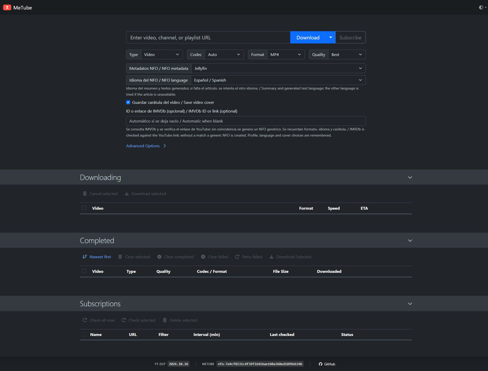

# MeTube NFO


Download music videos with artist folders, NFO metadata and JPG covers for Jellyfin, Kodi and Emby. Based on [MeTube](https://github.com/alexta69/metube).



*NFO controls from revision `7e4cf8131c4f39f16416ae160a368ed1899eb34b`. NFO generation defaults to disabled; its language defaults to Spanish.*

## What this fork adds

* **NFO profiles:** choose Jellyfin, Kodi or Emby from the video form. Profiles currently use a shared music-video XML subset.
* **Verified video metadata:** IMVDb matches are checked against the YouTube video reference. Unmatched videos receive a generic NFO with source references, without borrowing another video's credits.
* **Artist folders:** reuse or create the artist directory and use the song title for the filename. MusicBrainz can help identify the artist when the primary sources lack it.
* **Genres and song descriptions:** MusicBrainz genres with Apple catalog fallback; Wikipedia introductions reached through MusicBrainz relationships, with attribution and the YouTube link.
* **Spanish or English:** remembered NFO language selection and Spanish-first bilingual NFO controls. Missing Wikipedia articles fall back to the other language; names and catalog genres are not automatically translated.
* **Local artwork:** optional `-poster.jpg` cover alongside the video and NFO.
* **Existing-library tooling:** preview-first NFO regeneration with reviewed apply plans and backups. Downloads preserve existing NFO files.

Metadata is best-effort: availability varies by provider and a metadata failure does not discard a successful video download. IMVDb requires your own API key; never commit it to the repository.

Read the [NFO and artist-folder guide](https://github.com/tool12/metube-nfo/blob/master/docs/nfo.md), [TrueNAS installation guide](https://github.com/tool12/metube-nfo/blob/master/docs/truenas.md) and [existing-library regeneration instructions](https://github.com/tool12/metube-nfo/blob/master/docs/nfo.md#existing-library-preview-review-and-apply).

## MeTube features

MeTube is a self-hosted web UI for [yt-dlp](https://github.com/yt-dlp/yt-dlp). Paste a link from YouTube or [hundreds of other sites](https://github.com/yt-dlp/yt-dlp/blob/master/supportedsites.md), and it downloads to your server:

* Video, audio, subtitles and thumbnails — from single videos, whole playlists or entire channels.
* [Subscriptions](https://github.com/alexta69/metube/wiki/Subscriptions) to channels and playlists, which queue new uploads as they appear.
* Per-download choices of quality, format and folder, plus server-wide [yt-dlp options and presets](https://github.com/alexta69/metube/wiki/yt-dlp-options).

📖 **Guides, recipes and a troubleshooting FAQ live in the [wiki](https://github.com/alexta69/metube/wiki)** — many feature requests are already a recipe there, so check it before filing one.

## Quick start

```bash
docker run -d -p 8081:8081 -v /path/to/downloads:/downloads ghcr.io/tool12/metube-nfo:latest
```

Or with Docker Compose:

```yaml
services:
  metube:
    image: ghcr.io/tool12/metube-nfo:latest
    container_name: metube
    restart: unless-stopped
    ports:
      - "8081:8081"
    volumes:
      - /path/to/downloads:/downloads
```

Then open `http://<host>:8081` in your browser. This fork currently publishes Linux amd64 images to `ghcr.io/tool12/metube-nfo`; see the NFO guide for commit tags and deployment.

## Configuration

MeTube is configured with environment variables: `-e NAME=value` on the `docker run` command line, or the `environment:` section in Compose. Defaults are the Docker image's; outside Docker, the directories default to the working directory.

### Runtime and permissions

| Variable | Default | Description |
| :--- | :--- | :--- |
| `PUID` / `PGID` | `1000` | User and group MeTube runs as and writes files with. Legacy `UID`/`GID` also work. |
| `UMASK` | `022` | Umask for the files MeTube creates. |
| `CHOWN_DIRS` | `true` | Make `PUID:PGID` the owner of the download, state and temp directories at startup. With `false`, MeTube's user must already have access. |
| `LOGLEVEL` | `INFO` | `DEBUG`, `INFO`, `WARNING`, `ERROR`, `CRITICAL` or `NONE`. |
| `ENABLE_ACCESSLOG` | `false` | Log every HTTP request. |
| `DEFAULT_THEME` | `auto` | UI theme: `light`, `dark`, or `auto` to follow the system. |

### Downloads

| Variable | Default | Description |
| :--- | :--- | :--- |
| `MAX_CONCURRENT_DOWNLOADS` | `3` | Downloads that run at once; the rest wait their turn. |
| `DEFAULT_OPTION_PLAYLIST_ITEM_LIMIT` | `0` | Default for the **Items Limit** field: how many entries of a playlist or channel to download (`0` = all). |
| `CLEAR_COMPLETED_AFTER` | `0` | Seconds before finished and failed downloads leave the Completed list (`0` = never). |
| `DELETE_FILE_ON_TRASHCAN` | `false` | Also delete the file from disk when its entry is removed from Completed. `ask` prompts each time. |
| `SUBSCRIPTION_DEFAULT_CHECK_INTERVAL` | `60` | Default minutes between checks of a [subscription](https://github.com/alexta69/metube/wiki/Subscriptions). |
| `SUBSCRIPTION_SCAN_PLAYLIST_END` | `50` | Newest entries fetched each time a subscription is checked. |
| `SUBSCRIPTION_MAX_SEEN_IDS` | `50000` | Video IDs remembered per subscription, to bound the state file's size. |

### Directories

| Variable | Default | Description |
| :--- | :--- | :--- |
| `DOWNLOAD_DIR` | `/downloads` | Where downloads are saved. |
| `AUDIO_DOWNLOAD_DIR` | same as `DOWNLOAD_DIR` | Where audio-only downloads are saved, to keep them apart from video. |
| `TEMP_DIR` | `/downloads` | Where files are written while downloading. An SSD or `tmpfs` is faster, but on a RAM disk interrupted downloads can't resume. |
| `STATE_DIR` | `/downloads/.metube` | Where MeTube keeps its queue, history, subscriptions and uploaded cookies. |
| `CUSTOM_DIRS` | `true` | Show a **Download Folder** field under Advanced Options, to save into a subfolder of the download directory. |
| `CREATE_CUSTOM_DIRS` | `true` | Let that field create folders that don't exist yet. |
| `CUSTOM_DIRS_EXCLUDE_REGEX` | `(^\|/)[.@].*$` | Folders left out of the field's suggestions; the default hides names starting with `.` or `@`. Empty hides none. |
| `DEFAULT_FOLDER` | | Folder the field starts with, relative to the download directory. Requires `CUSTOM_DIRS`. |
| `DOWNLOAD_DIRS_INDEXABLE` | `false` | Serve browsable listings of the download directories. |

### File naming

Templates use [yt-dlp's output template syntax](https://github.com/yt-dlp/yt-dlp/blob/master/README.md#output-template). How MeTube applies them is explained in [Output templates](https://github.com/alexta69/metube/wiki/Output-templates).

| Variable | Default | Description |
| :--- | :--- | :--- |
| `OUTPUT_TEMPLATE` | `%(title)s.%(ext)s` | Filename for downloads. |
| `OUTPUT_TEMPLATE_PLAYLIST` | `%(playlist_title)s/%(title)s.%(ext)s` | Filename for items added from a playlist. Empty means `OUTPUT_TEMPLATE`. |
| `OUTPUT_TEMPLATE_CHANNEL` | `%(channel)s/%(title)s.%(ext)s` | Filename for items added from a channel. Empty means `OUTPUT_TEMPLATE`. |
| `OUTPUT_TEMPLATE_CHAPTER` | `%(title)s - %(section_number)02d - %(section_title)s.%(ext)s` | Default filename for each chapter when **Split by chapters** is on. |

### yt-dlp

| Variable | Default | Description |
| :--- | :--- | :--- |
| `IMVDB_APP_KEY` | | Private server-side IMVDb V1 key; see the [NFO guide](https://github.com/tool12/metube-nfo/blob/master/docs/nfo.md). |
| `IMVDB_SEARCH_ENABLED` | `false` | Opt in to IMVDb V1 title search after its announced temporary shutdown ends; direct video ID lookups remain available. |
| `IMVDB_WEB_SEARCH_ENABLED` | `true` | Discover video IDs through IMVDb public search pages while API search is suspended; candidates are verified against the original YouTube ID. |
| `ARTIST_FOLDERS` | `true` | Put video downloads and their sidecars in artist folders, reusing an existing matching folder where possible. |
| `YTDL_OPTIONS` | `{}` | Options for every download, as a JSON object — see [yt-dlp options](#yt-dlp-options). |
| `YTDL_OPTIONS_FILE` | | Path to a JSON file of such options. Reloaded when it changes; wins over `YTDL_OPTIONS` for the same key. |
| `YTDL_OPTIONS_PRESETS` | `{}` | Named option bundles, picked per download in the UI. |
| `YTDL_OPTIONS_PRESETS_FILE` | | Path to a JSON file of presets. Reloaded when it changes; wins over `YTDL_OPTIONS_PRESETS` for the same name. |
| `ALLOW_YTDL_OPTIONS_OVERRIDES` | `false` | Show a field for per-download yt-dlp options in the UI. Trusted users only: it allows running commands in the container. |
| `YTDL_NIGHTLY_UPDATE_TIME` | | Use [nightly yt-dlp builds](https://github.com/yt-dlp/yt-dlp-nightly-builds), upgrading and restarting daily at this time (`HH:MM`, 24-hour). |

### Web server and network

| Variable | Default | Description |
| :--- | :--- | :--- |
| `HOST` | `0.0.0.0` | Address to listen on. The default is every IPv4 interface; `*` (or empty) adds IPv6; `::` is IPv6 only. |
| `PORT` | `8081` | Port to listen on. |
| `URL_PREFIX` | `/` | Base path, for serving MeTube under a subpath of a [reverse proxy](https://github.com/alexta69/metube/wiki/Reverse-proxy-configurations). |
| `HTTPS` | `false` | Serve HTTPS directly, using `CERTFILE` and `KEYFILE`. |
| `CERTFILE` / `KEYFILE` | | Paths to the HTTPS certificate and key. |
| `PUBLIC_HOST_URL` | `download/` | Base URL for the links to completed files. The default is relative to MeTube itself; set a full URL if the files are served from elsewhere. |
| `PUBLIC_HOST_AUDIO_URL` | `audio_download/` | The same, for audio downloads. |
| `CORS_ALLOWED_ORIGINS` | | Comma-separated origins allowed to call MeTube from other sites, as [browser extensions and bookmarklets](https://github.com/alexta69/metube/wiki/Sending-links-to-MeTube) do. `*` allows any site, so prefer naming them. |
| `ALLOW_PRIVATE_ADDRESSES` | `false` | Allow URLs on private and internal addresses, turning off SSRF protection. Needed for Fake-IP proxy clients, not for ordinary proxies — [details](https://github.com/alexta69/metube/wiki/Troubleshooting-FAQ#refusing-to-fetch-internal-host-proxies-and-vpns). |
| `ROBOTS_TXT` | | Path to a `robots.txt` file to serve, mounted into the container. |

## yt-dlp options

yt-dlp options are JSON objects keyed by yt-dlp's [API option names](https://github.com/yt-dlp/yt-dlp/blob/master/yt_dlp/YoutubeDL.py#L224), which differ from its command-line flags ([converter](https://github.com/yt-dlp/yt-dlp/blob/master/devscripts/cli_to_api.py)). They apply at three levels, and for an option set at more than one, the more specific level wins:

1. **Global** — `YTDL_OPTIONS` and `YTDL_OPTIONS_FILE`, for every download.
2. **Presets** — `YTDL_OPTIONS_PRESETS` and `YTDL_OPTIONS_PRESETS_FILE`, picked per download under **Advanced Options**.
3. **Overrides** — typed into the UI for a single download, when `ALLOW_YTDL_OPTIONS_OVERRIDES` is on.

```yaml
environment:
  - 'YTDL_OPTIONS={"writesubtitles": true, "subtitleslangs": ["en", "de"], "updatetime": false}'
```

The [yt-dlp options guide](https://github.com/alexta69/metube/wiki/yt-dlp-options) covers presets, overrides and option files in detail, and the [YTDL_OPTIONS Cookbook](https://github.com/alexta69/metube/wiki/YTDL_OPTIONS-Cookbook) has ready-made recipes.

## Guides

The [wiki](https://github.com/alexta69/metube/wiki) covers everything beyond the reference above:

* [Subscriptions](https://github.com/alexta69/metube/wiki/Subscriptions) — download new uploads from channels and playlists automatically.
* [yt-dlp options](https://github.com/alexta69/metube/wiki/yt-dlp-options) and the [YTDL_OPTIONS Cookbook](https://github.com/alexta69/metube/wiki/YTDL_OPTIONS-Cookbook) — notifications, embedded metadata, subtitles and more.
* [Output templates](https://github.com/alexta69/metube/wiki/Output-templates) and the [OUTPUT_TEMPLATE Cookbook](https://github.com/alexta69/metube/wiki/OUTPUT_TEMPLATE-Cookbook) — how files are named and sorted into folders.
* [Using browser cookies](https://github.com/alexta69/metube/wiki/Using-browser-cookies) — for private, age-restricted and "confirm you're not a bot" videos.
* [Sending links to MeTube](https://github.com/alexta69/metube/wiki/Sending-links-to-MeTube) — browser extensions, bookmarklets, iOS, Android and Windows apps, Raycast.
* [HTTPS and reverse proxies](https://github.com/alexta69/metube/wiki/Reverse-proxy-configurations) — NGINX, Apache, Caddy and swag examples, and adding authentication.
* [Hardware-accelerated transcoding](https://github.com/alexta69/metube/wiki/Hardware-accelerated-transcoding) — re-encode downloads on an Intel or AMD GPU.
* [yt-dlp plugins](https://github.com/alexta69/metube/wiki/yt-dlp-plugins) — extend yt-dlp, e.g. to accept links from Invidious or Piped.
* [Troubleshooting FAQ](https://github.com/alexta69/metube/wiki/Troubleshooting-FAQ) — common problems and how to diagnose them.

## Keeping yt-dlp up to date

Sites change constantly, and yt-dlp keeps up with frequent releases. This fork publishes an image after successful builds on master; integrate and test upstream updates before deploying them. Keep your container updated — [watchtower](https://github.com/nicholas-fedor/watchtower) can do it for you. To follow yt-dlp's nightly builds instead, set `YTDL_NIGHTLY_UPDATE_TIME`.

## Troubleshooting and support

MeTube is only a UI for yt-dlp, so most download failures are yt-dlp's. Reproduce them with yt-dlp inside the container, and once a set of options works there, carry it over to `YTDL_OPTIONS`:

```bash
docker exec -ti metube sh
cd /downloads
yt-dlp <url>
```

The [Troubleshooting FAQ](https://github.com/alexta69/metube/wiki/Troubleshooting-FAQ) covers common problems. Ask questions in [Discussions](https://github.com/alexta69/metube/discussions/categories/q-a); [issues](https://github.com/alexta69/metube/issues) are for bugs in MeTube itself.

## Scope and contributing

Upstream MeTube's scope is deliberately narrow: it downloads well, and stops once the file is written. Tagging and library organization belong to dedicated tools — point [beets](https://beets.io) (headless, scriptable), [MusicBrainz Picard](https://picard.musicbrainz.org) (GUI, acoustic fingerprinting) or [Lidarr](https://lidarr.audio) (full library manager) at your `AUDIO_DOWNLOAD_DIR`.

Feature requests that fit this scope are welcome, and so are pull requests — for a change that isn't obvious, start a discussion first. [CONTRIBUTING.md](https://github.com/alexta69/metube/blob/master/CONTRIBUTING.md) has the scope policy and how to build and run MeTube locally.
